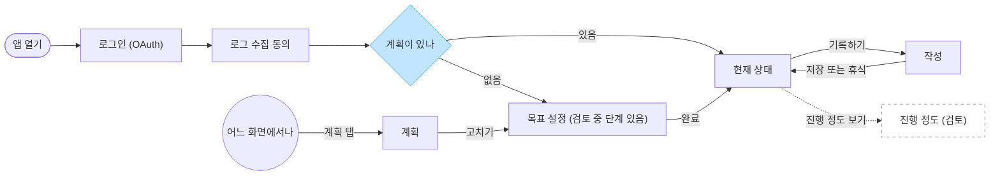
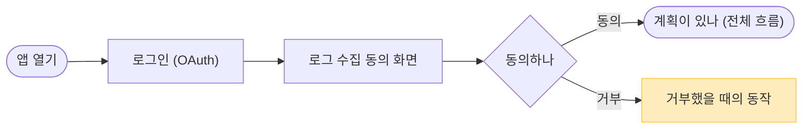
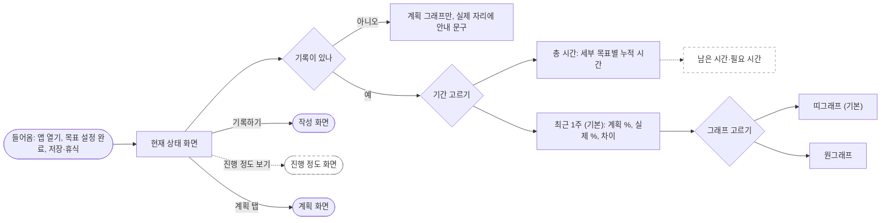
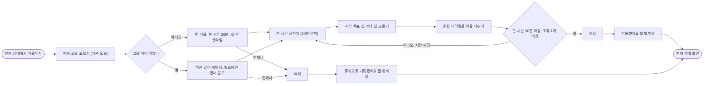
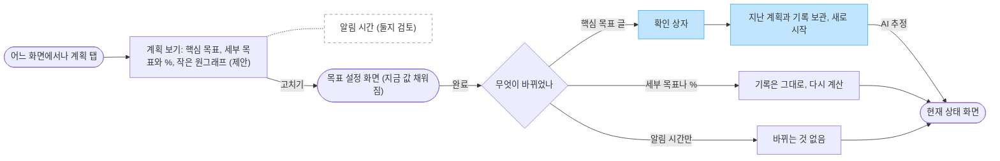
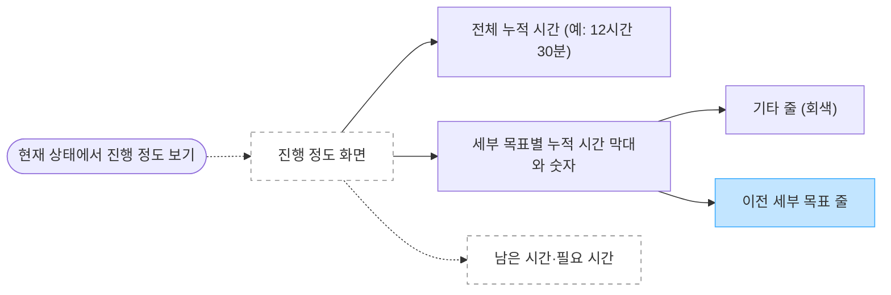

# 이번 판 사용자 흐름

이번 판(팀 프로토타입)의 사용자 흐름을 Mermaid 흐름도로 그린 것이다. 1절은 화면 사이를 오가는 전체 흐름이고, 2절부터는 화면마다 그 안에서 사용자가 무엇을 하고 어디로 나가는지를 그렸다. 실선은 지금 정해진 흐름이고, 점선은 사용자가 넣을지 검토 중인 것이다.

- 작성 출처: [AI 초안]. 무엇을 점선으로 둘지와 아래 "사용자가 정한 것"은 사용자 답(2026-10-14).
- 승인 상태: 사용자 확인 대기.
- 근거: 공개 화면 명세 duno-docs/duno-screens-and-rules.md 1~6절, 결정 D-040·D-041·D-042·D-043, 질문 Q-053·Q-054·Q-056·Q-057·Q-058.

## 읽는 법
| 표시 | 뜻 |
|---|---|
| 실선 | 정해진 흐름. PM 결정이거나 시각화 자료의 현재 동작 |
| 점선, 점선 테두리 | 사용자가 넣을지 검토 중인 것. 정하지 않았다 |
| 파란 상자 | AI 제안. PM 확인 전 |
| 노란 상자 | 동작이 정해지지 않은 것 |
| "AI 추정" 선 | 문서에 없어 AI가 이은 것 |
| 둥근 끝 상자 | 이 화면으로 들어오는 곳이나 나가는 곳 |

피그잼에 올리면 상자의 점선 테두리는 빠지고 선의 점선만 남는다.

## 1. 전체 흐름 (화면 사이)
화면 하나를 상자 하나로 그렸다. 화면 안의 단계와 갈림은 2~7절에 있다(사용자 2026-10-14, 화면 단위로 줄이는 방법).

- 목표 설정 안의 ④ 알림 설정, ⑤ 주간 목표 시간, ⑥ 핵심 목표 기간(검토 중)은 3절에 있다.
- 계획에서 고치기를 거쳐 완료하면 현재 상태로 가기 전에 "바뀐 것 처리"를 지난다. 핵심 목표 글을 바꿨을 때의 확인 상자와 보관도 여기에 들어간다. 6절에 있다.
- 남은 시간·필요 시간은 화면이 아니라 화면 안에 보이는 값이라 4절과 7절에 그렸다.

## 2. 로그인과 동의
정해진 것은 순서뿐이다. 로그인(OAuth, D-040) 뒤에 로그 수집 동의 화면이 온다(사용자 2026-10-14). 동의 화면의 나머지 세부는 Q-053에 남아 있다.

- 거부하면 서비스를 쓸 수 있는지, 로그만 모으지 않는지는 정하지 않았다(Q-053 ③).
- 동의 화면이 열 때마다 뜨는지 처음 한 번만 뜨는지는 정하지 않았다(Q-053). 로그인을 유지할지, 로그인 화면의 모양, OAuth 제공자는 개발 담당의 영역이다.

## 3. 목표 설정 화면
한 단계씩 넘어간다. 화면 위에 단계 표시와 단계 이름이, 아래에 이전·다음 버튼이 있고 마지막 단계에서는 완료 버튼이 나온다. 처음 계획을 만들 때와 계획 화면에서 고치기를 눌렀을 때 같은 화면을 쓴다.

```mermaid
flowchart LR
    entryNew(["처음 (계획 없음)"])
    entryEdit(["계획 화면에서 고치기"])
    filled["지금 값이 채워진 채 시작"]
    s1["① 핵심 목표 입력 (25자까지)"]
    c1{"비어 있나"}
    s2["② 세부 목표 고르기 (예시 칩, 직접 적기, 8개까지)"]
    c2{"2개 이상인가"}
    s3["③ 비율 정하기 (원형 다이얼, 숫자 칸, 균등 배분)"]
    s4["④ 알림 시간 (기본 21:00)"]
    s5["⑤ 주간 목표 시간"]
    s6["⑥ 핵심 목표 기간"]
    fin{"어디서 들어왔나"}
    toStatus(["현재 상태 화면"])
    toPlan(["계획 화면의 바뀐 것 처리"])

    entryNew --> s1
    entryEdit --> filled --> s1
    s1 --> c1
    c1 -->|"예, 다음 못 감"| s1
    c1 -->|"아니오"| s2
    s2 --> c2
    c2 -->|"아니오, 다음 못 감"| s2
    c2 -->|"예"| s3
    s3 --> s4
    s4 -->|"완료"| fin
    s4 -.-> s5 -.-> s6
    s6 -.->|"완료"| fin
    fin -->|"처음"| toStatus
    fin -->|"고치기"| toPlan

    classDef review fill:#FFFFFF,stroke:#8C8C8C,stroke-dasharray:5 5
    class s4,s5,s6 review
```

- ② 고른 순서가 계획 순서다. 세부 목표 이름은 15자까지다. 같은 이름을 허용할지는 정하지 않았다.
- ③ 처음 들어오면 균등으로 나누고 남는 몫은 앞부터 1씩 준다. 첫 세부 목표가 골라진 채 시작한다. 고치기로 들어왔을 때는 균등으로 되돌리지 않는다(화면 명세 7-4).
- ④는 알림이 없는 이번 판에 둘지 검토 중이다(Q-054). ⑤⑥은 받을지 검토 중이다(Q-056). ⑤⑥의 입력 형태는 정하지 않았다(Q-057 ⑤).
- 각 단계의 이전 버튼은 그리지 않았다.

## 4. 현재 상태 화면
지금까지 쌓인 계획과 실제를 견주는 메인 화면이다. 맨 위에 핵심 목표 한 줄이 있다.

- 최근 1주는 오늘을 넣은 7일이다(제안). 차이는 부호 붙은 숫자로만 보여 주고, 계획보다 시간을 더 쓴 세부 목표는 문장 한 줄로 알려 준다. 경고 색과 좋다·나쁘다 말은 없다.
- 총 시간 보기는 기록이 있는 모든 날을 센다. 진행 정도 화면을 두지 않아 누적 시간은 여기서 본다(D-042).
- 그래프 고르기를 최근 1주 아래에 그린 것은 AI 읽기다. 총 시간 보기에서 그래프 전환이 어떻게 보이는지는 문서에 없다.
- 기록하기 버튼은 기록이 없을 때도 있다.

## 5. 작성 화면
하루에 목표에 쓴 시간과 세부 목표별 비율을 적는 화면이다. 제목은 질문형이다.

- 칩을 누르면 원에 들어가고 다시 누르면 빠진다. 원 안의 자리는 누른 순서와 상관없이 계획 순서이고 기타는 마지막이다. 기타만 골라도 저장된다.
- 휴식으로 적은 날을 열면 안내 문구와 빈 칩이 보인다. 작성과 휴식은 서로 바꿀 수 있다.
- 지금은 없는 세부 목표의 몫이 있는 날을 열면 "저장하면 그 몫은 사라집니다"를 보인다. 저장하지 않으면 원래 기록은 그대로다.
- 원형 다이얼의 세부 규칙은 화면 명세 7절에 있어 그리지 않았다.

## 6. 계획 화면
정한 계획을 보고 고치는 화면이다. 어느 화면에서나 계획 탭으로 연다.

- 세부 목표를 빼도 그 세부 목표에 쌓인 시간은 남긴다. 비율은 균등으로 되돌리지 않는다. 이름만 바꾸면 같은 세부 목표로 보고, 뺐던 이름을 다시 넣으면 새 세부 목표로 본다.
- 어느 경우든 계획 변경 이력에 한 줄 남긴다. 화면에는 보이지 않는다(제안).
- 확인 상자에서 취소하면 어떻게 되는지, 보관한 뒤 어느 화면이 열리는지는 문서에 없다. 둘 다 화면 동작이라 개발 담당의 영역으로 AI가 읽었다.
- ⑤ 주간 목표 시간과 ⑥ 핵심 목표 기간을 받기로 하면 계획 화면에 보일지는 정하지 않았다. 그려 두지 않았다.

## 7. 진행 정도 화면 (검토 중)
이번 판에는 두지 않기로 했으나(D-042) 사용자가 다시 검토 중이다(Q-058). 아래는 시각화 자료의 동작에 검토 중인 남은 시간·필요 시간을 더한 것이다.

- 가장 긴 막대를 100% 너비로 두고 나머지는 비례로 그린다(제안). 지금은 없는 세부 목표의 시간을 남기는 것은 결정이고, "이전 세부 목표" 한 줄로 묶어 보여 주는 것은 제안이다.
- 시각화 자료에는 "%, 남은 시간, 필요 시간은 없다"(PM 2026-10-13)가 정해져 있다. 남은 시간·필요 시간을 넣으면 이 결정을 다시 여는 것이다.
- 이 화면에서 돌아가는 길은 문서에 없어 그리지 않았다.

## 사용자가 정한 것
흐름도를 고치며 사용자가 답한 것이다(2026-10-14). 결정 기록에는 아직 올리지 않았다.

| 무엇 | 답 | 이어지는 질문 |
|---|---|---|
| 로그 수집 동의 화면의 자리 | 로그인 뒤 | Q-053 ② |
| 주간 목표 시간을 받는 목적 | 남은 시간과 필요 시간을 보여 주는 것 | Q-056 |
| 남은 시간·필요 시간이 보이는 곳 | 진행 정도 화면과 현재 상태 화면의 총 시간 보기 둘 다 | Q-056, Q-058 |
| "주"의 범위 | 월요일부터 일요일까지의 달력 주 | Q-057 |
| 핵심 목표 기간의 쓰임 | 필요 시간 계산에 들어간다 | Q-057 |

## 검토 중인 것
점선으로 그린 것과 각각 정하지 않은 것이다.

| 무엇 | 정하지 않은 것 | 질문 |
|---|---|---|
| ④ 알림 설정, 계획 화면의 알림 시간 | 알림이 없는 이번 판에 둘지 | Q-054 |
| ⑤ 주간 목표 시간, ⑥ 핵심 목표 기간 | 목표 설정에서 받을지 | Q-056 |
| 남은 시간·필요 시간 | 핵심 목표 남은 시간, 주간 목표 남은 시간, 필요 시간을 각각 어떻게 계산하는지. 사용자: 정확히 정해야 하고 헷갈린다 | Q-057 |
| 진행 정도 화면 | 두지 않기로 한 결정(D-042)을 다시 열지 | Q-058 |

## 제안과 AI 추정
- 처음 열 때 계획이 없으면 목표 설정 화면, 있으면 현재 상태 화면으로 가는 갈림은 제안이다(화면 명세 1절).
- 핵심 목표 글을 바꾸면 확인 상자를 띄우고 지난 계획과 기록을 보관한 뒤 새로 시작하는 처리는 제안이다(화면 명세 6절).
- 보관한 뒤 현재 상태 화면으로 가는 선, 현재 상태 화면에서 그래프 고르기를 최근 1주 아래에 둔 것은 AI 추정이다.

## 그리지 않은 것
- 이번 판에 없는 것: 알림(D-041).
- 원형 다이얼의 세부 규칙(화면 명세 7절), 실제 비율과 시간 계산(8절).
- 목표 설정의 이전 버튼, 진행 정도 화면에서 돌아가는 길, 확인 상자에서 취소하는 길.

## 검토할 때 부딪히는 기록
- [사실] 시각화 자료의 옛 의도 I5: "입력은 편해야 한다. 목표 설정에서 시간을 묻지 않고, 저녁엔 쓴 시간과 비율만 받는다." 옛 미결 정리: "목표 기간·주간 목표 시간·총 시간: 한때 S1에 넣었다가 뺌. 할 일과 함께 나중에." 둘 다 slot-in-prototype 커밋 d832716의 01-intent.md와 07-open-items.md에 있고, 지금 파일은 지워졌다. 공개 화면 명세 2절도 "시간이나 기간을 묻는 칸은 없다(결정)"이다.
- [사실] 진행 정도 화면에 "%, 남은 시간, 필요 시간은 없다"(PM 2026-10-13, 같은 커밋 02-screens.md). 남은 시간·필요 시간을 보여 주면 이 결정을 다시 여는 것이다.
- [사실] 진행 정도 화면을 두지 않는 것은 PM과 개발 담당이 논의해 확정했다(D-042). 다시 열면 개발 담당과 함께 본다.
- [AI 읽기] 이번 판은 알아차리게 하기이고 먼저 하게 하기는 다음 판이다(D-029, D-035). 남은 시간·필요 시간이 해야 할 양을 알려 주는 재촉으로 읽히면 이 경계에 걸린다.
- [추론, 확인 안 됨] 지금 재는 것은 비율의 편향이다(D-030). 시간 목표가 생기면 사용자가 비율보다 총량을 쫓아 재는 값이 흐려질 수 있다.
